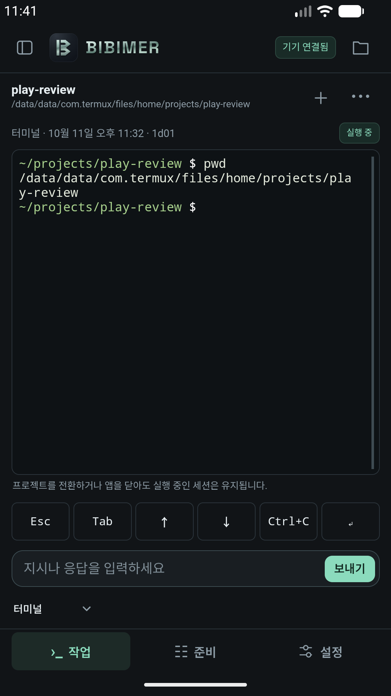
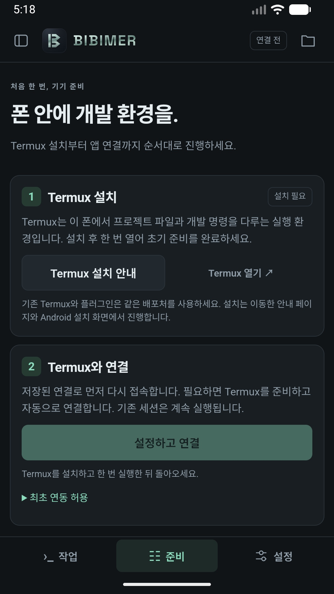
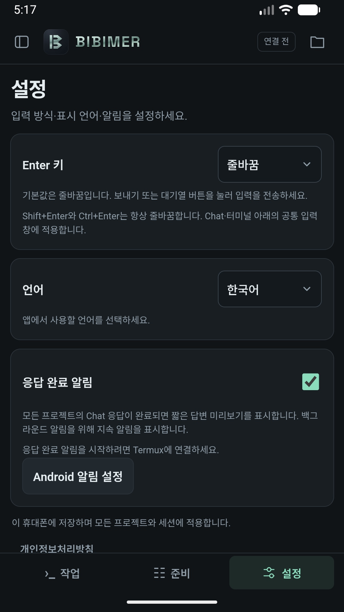

# BIBIMER · 비비머

**내 손안의 에이전트 개발 환경.**

[English](README.md) · 한국어

[웹사이트](https://bibimer.app/ko/) · [개인정보처리방침](https://bibimer.app/ko/privacy/) · [지원 문의](mailto:andy@andineering.com)

Bibimer는 프로젝트, Git 워크트리, 코딩 에이전트 세션, 대화, 터미널을 한곳에서 관리하는 Android 앱입니다. 프로젝트 파일과 개발 도구는 **같은 휴대폰의 Termux**에 있습니다. 별도의 개발 컴퓨터나 원격 호스트 없이 스마트폰에서 직접 개발을 진행하세요.

Android 휴대폰도 개발 환경이 될 수 있습니다. Termux를 설치하면 Linux 명령줄 환경에서 Git, Python, Node.js 등 다양한 개발 도구를 사용할 수 있습니다. Bibimer는 이 환경을 휴대폰에서 다루기 편하게 연결합니다. 프로젝트를 열고 터미널 명령을 실행하거나 에이전트에게 작업을 맡긴 뒤 결과를 확인하세요.

Bibimer는 **ADE(Agent Development Environment, 에이전트 개발 환경)**입니다. 실제 코딩 작업은 연결한 Codex, Claude Code, OpenCode 같은 에이전트가 수행합니다. 에이전트는 Termux에서 실행 가능한 설치본과 필요한 제공자 인증을 따로 준비해야 합니다.

## 왜 비비머인가요?

Android 앱, Termux, 코딩 에이전트를 하나로 비볐습니다. 세 가지를 함께 쓰는 개발 환경이라는 뜻을 담아, **‘비빔’에 ‘-er’를 붙여 Bibimer(비비머)**라는 이름을 지었습니다.

## 설치와 배포

[Google Play](https://play.google.com/store/apps/details?id=app.bibimer)에서 Bibimer를 설치할 수 있습니다. **정식 버전은 0.20.0이며, 초대받은 내부 테스터에게는 0.22.0을 제공합니다.** GitHub 공개 APK 배포본은 없으며 개발 버전 빌드는 [빌드 안내](docs/development.md)를 참고하세요.

앱의 최소 Android 버전은 8.0(API 26)입니다. 모든 Android 버전과 기기, 에이전트 설치 환경에서 동작을 확인한 것은 아닙니다.

0.20.0 이상은 영어·한국어·브라질 포르투갈어·스페인어·인도네시아어·중국어 간체·일본어·중국어 번체(대만·홍콩)·프랑스어·독일어를 지원합니다. [언어 확대 우선순위](docs/localization.md)를 참고하세요.

0.20.0 이상은 기기 언어 목록에서 지원 언어를 찾고, 없으면 영어로 표시합니다. 앱에서 직접 선택한 언어가 있으면 그 선택을 우선합니다.

## 주요 기능

- **휴대폰에서 직접 개발하세요.** Termux에 프로젝트 파일을 두고 개발 명령과 호환되는 코딩 에이전트를 같은 기기에서 실행합니다.
- **작업 공간을 정리하세요.** 사이드바에서 프로젝트, 기존 Git 워크트리, 여러 에이전트 세션을 오갈 수 있습니다.
- **대화와 터미널을 함께 쓰세요.** 에이전트의 답변과 도구 실행을 읽고 승인 요청에 응답하거나 대화형 셸을 직접 사용합니다.
- **진행 중인 작업을 이어가세요.** 후속 지시를 대기열에 넣고 지원되는 모델과 옵션을 고르세요. 다른 에이전트에게 대화를 전달할 때는 내용을 먼저 확인합니다.
- **파일과 Git 변경을 확인하세요.** 프로젝트 파일과 diff를 살펴보고 GitHub 저장소를 원하는 Termux 폴더로 가져옵니다.
- **사용 방식을 설정하세요.** 10개 언어, Enter 키 동작, 응답 완료 알림을 선택합니다. 알림 전달은 Android 권한과 백그라운드 실행 제약의 영향을 받습니다.

## 주요 화면

**로컬 터미널 · Termux 준비 · 설정**

<p>
  <a href="release/google-play/screenshots/ko-KR/04-terminal.png"></a>
  <a href="release/google-play/screenshots/ko-KR/02-setup.jpg"></a>
  <a href="release/google-play/screenshots/ko-KR/03-settings.jpg"></a>
</p>

이미지를 누르면 원본 크기로 볼 수 있습니다. 모두 Android 에뮬레이터에서 캡처한 실제 앱 화면입니다. 터미널 화면은 같은 기기의 Termux 프로젝트에서 셸 명령을 실행한 결과입니다.

## 처음 사용하기

Bibimer와 Termux를 **같은 Android 휴대폰**에 설치하세요. 터미널부터 사용해 보고 에이전트 기능이 필요할 때 설치와 인증을 진행해도 됩니다.

### 1. Termux 준비

[Termux 공식 설치 안내](https://github.com/termux/termux-app#installation)에 나온 배포처에서 설치한 뒤 한 번 실행해 초기 준비를 마칩니다. 프로젝트 파일과 개발 도구, 실행 세션은 이 환경에서 다룹니다.

### 2. Bibimer 연결

앱의 **준비** 화면을 엽니다. 수동 연결은 다음 순서로 진행합니다.

1. **수동 설치·코드 연결**을 펼치고 **설정 파일 저장**을 누릅니다.
2. Android 다운로드 폴더에 `bibimer-setup.sh`라는 이름으로 저장합니다.
3. Termux에서 `termux-setup-storage`를 실행하고 파일 접근 요청을 허용합니다. 이미 다운로드 폴더를 사용할 수 있다면 생략합니다.
4. 권한 허용이 끝난 뒤 다음 명령을 실행합니다.

   ```sh
   bash ~/storage/downloads/bibimer-setup.sh
   ```

5. 스크립트가 필요한 Python과 로컬 Bibimer 브리지를 준비하고 실행합니다. Termux에 표시된 일회용 코드를 Bibimer의 **이 앱 연결**에 입력합니다.

앱의 **설정하고 연결** 기능을 쓰려면 Android의 Termux 명령 실행 권한과 Termux의 외부 앱 연동 설정이 필요합니다. 앱 안내에 따라 허용하세요. 자동 연결 전체 과정은 추가 기기 검증이 남아 있으며 수동 연결과 터미널 사용은 Android 에뮬레이터에서 확인했습니다.

### 3. 프로젝트 열기

사이드바에서 **프로젝트 추가**를 누릅니다. Termux 폴더를 찾아 선택하거나 `~/projects/my-project` 같은 경로를 입력하고 필요하면 새 폴더 만들기를 선택합니다. 프로젝트를 등록한 뒤 **터미널**을 고르고 새 세션을 시작하세요.

입력창에서 `pwd` 같은 셸 명령을 실행해 보세요. 명령은 휴대폰에 있는 해당 프로젝트 폴더에서 실행됩니다.

### 4. 코딩 에이전트 연결

[Termux 에이전트 설치 안내](docs/termux-agents.md)를 참고해 Codex, Claude Code, OpenCode 설치본을 준비하고 필요한 제공자 로그인이나 API 설정을 마칩니다. 현재 폰에서 확인한 패키지·전용 런타임·래퍼와 필요한 선행 환경을 안내합니다. Bibimer에서 에이전트를 고르고 세션을 시작하세요. 모델과 옵션은 설치한 에이전트가 지원하는 항목에 따라 달라집니다. 일반 Linux 설치 안내가 Android·Termux에서도 그대로 동작하는 것은 아닙니다.

앱은 기기 언어 목록을 따르고 지원하는 언어가 없으면 영어로 표시합니다. **Settings → Language**에서 직접 선택한 언어를 저장하거나 시스템 설정을 따르도록 되돌릴 수 있습니다. 사용자 입력과 프로젝트 이름, 터미널 출력은 번역하지 않습니다.

## 세션과 데이터

화면을 옮기거나 Bibimer를 닫아도 세션 종료를 요청하지 않습니다. Termux와 브리지가 실행 중이면 다시 연결해 작업을 이어갑니다. Android가 백그라운드 프로세스를 종료할 수 있으며 브리지를 재시작해도 유실된 프로세스와 터미널 출력이 복원되지는 않습니다.

세션을 보관해도 진행 중인 작업은 유지합니다. 종료된 세션을 Bibimer 목록에서 지워도 프로젝트 파일과 에이전트 원본 기록은 Termux에 남습니다. 배포된 버전에서 워크트리 생성과 삭제는 Termux의 Git에서 진행합니다. 현재 개발 소스에는 사이드바에서 워크트리를 만들고 세션을 시작하는 기능이 추가됐습니다. 없는 로컬 브랜치는 새로 만들고 기존 브랜치는 재사용하며, 새 앱과 브리지 적용이 필요합니다. 워크트리 삭제는 Git에서 진행합니다.

앱은 같은 휴대폰의 루프백 주소로 브리지에 연결합니다. Bibimer에는 광고·분석 SDK가 없으며 대화를 Bibimer 운영 서버에 업로드하지 않습니다. **연결한 에이전트는 입력, 코드, 파일을 설정된 제공자나 도구에 전송할 수 있습니다.** 각 서비스의 요금과 정책은 별도로 적용됩니다. 자세한 내용은 [개인정보처리방침](https://bibimer.app/ko/privacy/)을 참고하세요.

## 도움말과 개발

- [자세한 설치·사용 안내와 문제 해결](docs/setup.md)
- [빌드와 개발 안내](docs/development.md)
- [버그 제보·기능 제안](https://github.com/andy5090/bibimer/issues)
- 지원 문의: [andy@andineering.com](mailto:andy@andineering.com)

**앤디니어링(Andineering)**이 개발합니다. Bibimer는 Termux 및 지원 에이전트 제작사와 독립적으로 운영됩니다.
