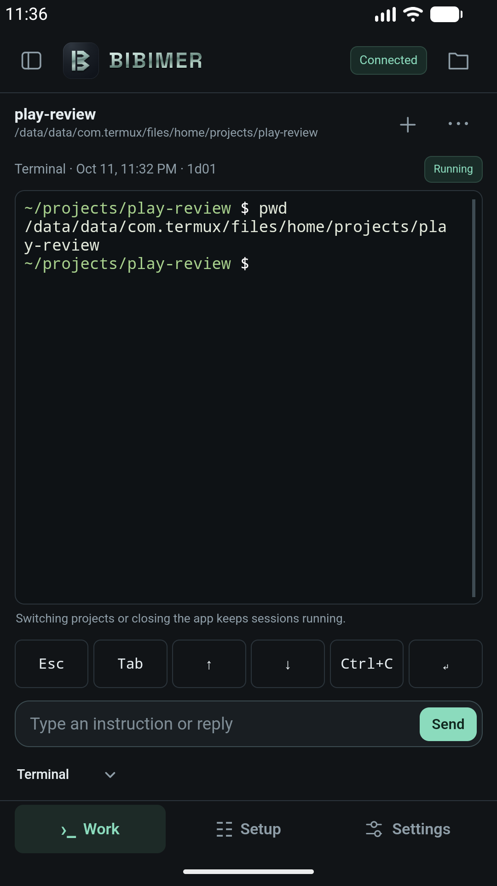
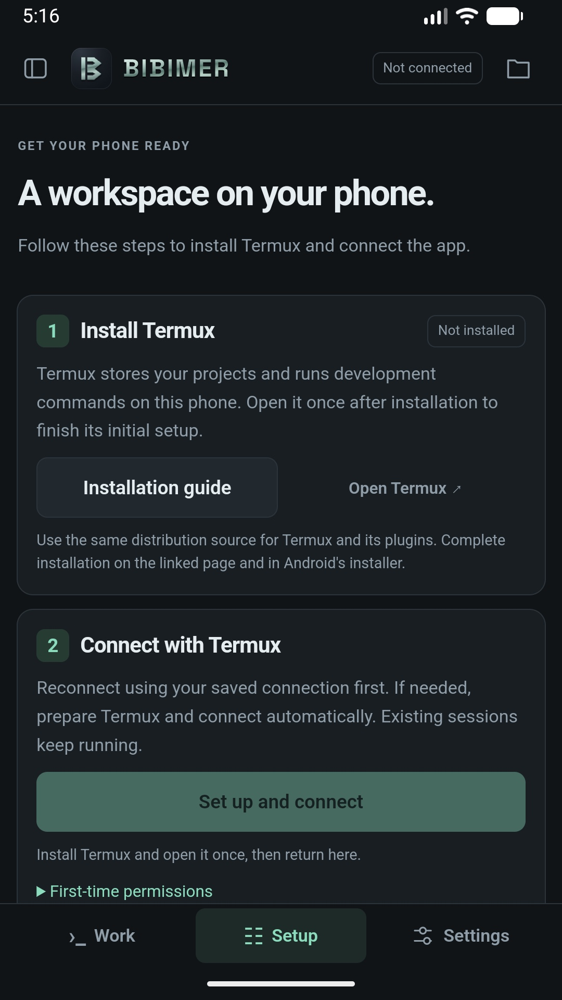
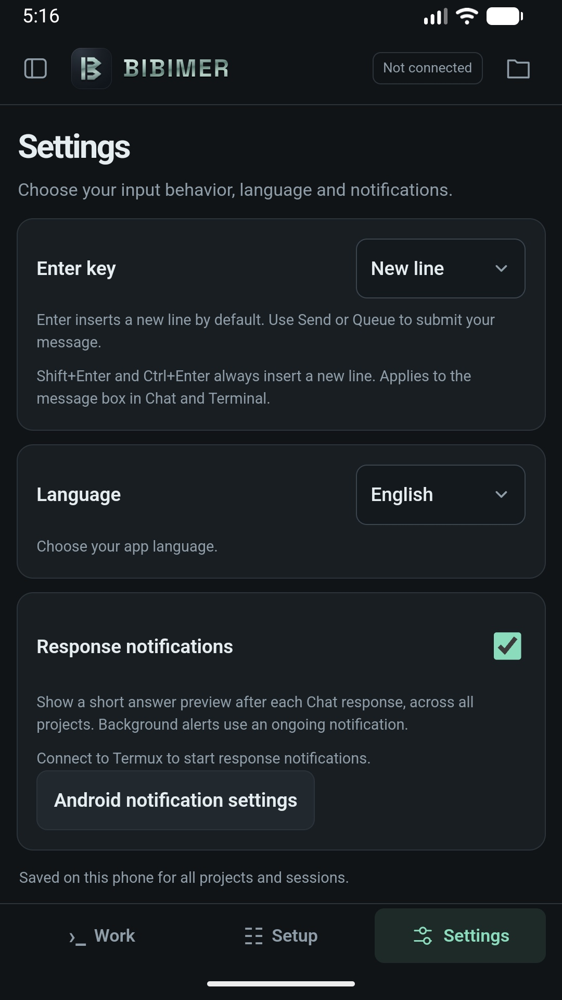

# BIBIMER

**An agent development environment on your Android phone.**

English · [한국어](README.ko.md)

[Website](https://bibimer.app/) · [Privacy](https://bibimer.app/privacy/) · [Support](https://bibimer.app/contact/)

Bibimer brings your projects, Git worktrees, coding-agent sessions, conversations, and terminals together in an Android app. Your project files and development tools live in **Termux on the same phone**, so you can develop directly on your smartphone without a separate development computer or remote host.

Modern Android phones can run a Linux command-line environment with Git, Python, Node.js, and many other development tools through Termux. Bibimer gives that environment a mobile interface: open a project, run a terminal, direct a compatible coding agent, and review its work from your phone.

Bibimer is an **ADE (Agent Development Environment)**. Connected agents such as Codex, Claude Code, and OpenCode perform the coding work. Each agent needs a Termux-compatible installation and any required provider authentication.

## Why Bibimer?

Bibimer takes its name from **비빔 (bibim)**, Korean for mixing things together, plus the suffix **-er**. It reflects the idea of mixing an Android app, Termux, and coding agents into one development environment.

## Availability

Bibimer is available on [Google Play](https://play.google.com/store/apps/details?id=app.bibimer). **The latest confirmed public release is 0.25.0. Version 0.28.1 was submitted for production review on October 23 and will publish automatically after Google approval.** Invited internal testers can already use 0.28.1. It includes compact model and permission controls, context and supported subscription usage indicators, Firefox with Termux:X11, and reopening saved agent chats after bridge updates. Update the Termux bridge to **0.21.0** from Settings for the browser and session reopening features. Interrupted work and queued messages are not replayed. There is no public GitHub APK release. To build from source, follow the [build guide](docs/development.md) (Korean).

The app targets Android 8.0 or later (API 26+). Compatibility with every Android version, device, or agent installation has not been verified.

Versions 0.20.0 and later support English, Korean, Brazilian Portuguese, Spanish, Indonesian, Simplified Chinese, Japanese, Traditional Chinese (Taiwan and Hong Kong), French, and German. It follows your device language list by default, falls back to English when none are supported, and preserves a saved manual choice. See the [localization roadmap](docs/localization.md) (Korean).

## What you can do

- **Develop on your phone.** Keep project files in Termux, run your development commands, and use compatible coding agents on the same device.
- **Organize your workspace.** Switch between projects, existing Git worktrees, and multiple agent sessions from the sidebar.
- **Use chat and a terminal.** Read structured agent responses and tool activity, respond to approval requests, or work directly in an interactive shell.
- **Manage ongoing work.** Queue follow-up instructions, choose supported models and options, and review the conversation context before passing it to another agent.
- **Inspect project files and Git changes.** Browse files, view diffs, and import GitHub repositories into a folder you choose in Termux.
- **Make the app yours.** Choose from ten supported languages, configure the Enter key, and enable response notifications. Delivery depends on Android permissions and background restrictions.

## Screenshots

**Local terminal · Termux setup · Settings**

<p>
  <a href="release/google-play/screenshots/en-US/04-terminal.png"></a>
  <a href="release/google-play/screenshots/en-US/02-setup.jpg"></a>
  <a href="release/google-play/screenshots/en-US/03-settings.jpg"></a>
</p>

Click a screenshot to view it at full size. These are actual Android emulator captures. The terminal shows a shell command running in a local Termux project.

## Get started

You need Bibimer and Termux installed on the **same Android phone**. Start with terminal mode; install and authenticate a coding agent when you want to use agent features.

### 1. Prepare Termux

Install Termux from a source listed in its [official installation guide](https://github.com/termux/termux-app#installation), then open it once and let its initial setup finish. Termux provides the command-line environment where your files, tools, and sessions run.

### 2. Connect Bibimer

Open Bibimer's **Setup** screen. The manual path is:

1. Expand **Manual setup and pairing** and choose **Save setup file**.
2. Save the file as `bibimer-setup.sh` in Android's Downloads folder.
3. In Termux, run `termux-setup-storage` and grant the requested file access. If the Downloads folder is already accessible, skip this step.
4. Once permission is granted, run:

   ```sh
   bash ~/storage/downloads/bibimer-setup.sh
   ```

5. The script prepares Python if needed, installs the local Bibimer bridge, and starts it. Enter the one-time code shown in Termux into Bibimer's **Connect this app** section.

The app also offers **Set up and connect**, which requires Android's Termux command permission and Termux's external-app integration setting. Follow the in-app prompts. The complete automatic setup flow still needs further device testing; manual connection and terminal use have been verified on an Android emulator.

### 3. Open a project

Open the sidebar and choose **Project Add**. Browse to a Termux folder, or enter a path such as `~/projects/my-project` and choose to create the folder if needed. Save the project, select **Terminal**, and start a session.

Try a shell command such as `pwd` from the input field. Your command runs in that project's folder on your phone.

### 4. Add a coding agent

Follow the [Termux agent installation guide](docs/termux-agents.en.md) for the packages, dedicated runtime, wrappers and prerequisites checked on our phone, including provider sign-in or API configuration. Choose the agent in Bibimer and start a session. Supported models and options depend on the installed agent. General Linux installation instructions do not guarantee Android/Termux compatibility.

The app follows your device language list by default and uses English when none are supported. Choose **Settings → Language** to save a manual choice or return to the system default. Your input, project names, and terminal output are not translated.

## Sessions and local data

Switching screens or closing Bibimer does not request that your sessions stop. Reconnect to continue while Termux and the bridge are still running. Android may stop background processes; restarting the bridge does not restore lost processes or their terminal output.

Archiving a session keeps its work running. Removing an ended session from Bibimer removes its listing, while project files and the agent's own history stay in Termux. The public release handles worktree creation and deletion through Git in Termux. Internal test version 0.25.0 adds sidebar worktree creation and session startup, creating a local branch when needed or reusing an existing one; this requires bridge 0.18.0. Worktree deletion stays in Git.

The app connects to a bridge on the phone's loopback address. Bibimer has no advertising or analytics SDK and does not upload your conversations to a Bibimer service. **A connected agent may send instructions, code, or files to its configured provider and tools.** Provider fees and policies apply separately. See the [privacy policy](https://bibimer.app/privacy/) for details.

## Help and development

Firefox with Termux:X11 is included in internal version 0.27.0 and bridge 0.20.0. See the [browser architecture and remaining validation](docs/architecture.md) (Korean).

- [Detailed setup and troubleshooting](docs/setup.md) (Korean)
- [Build and development guide](docs/development.md) (Korean)
- [Report a bug or request a feature](https://github.com/andy5090/bibimer/issues)
- Support: [Contact form](https://bibimer.app/contact/)

Developed by **Andineering**. Bibimer is independent of Termux and the supported agent providers.
